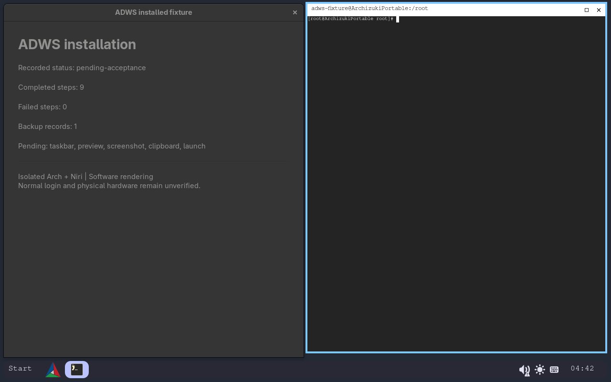
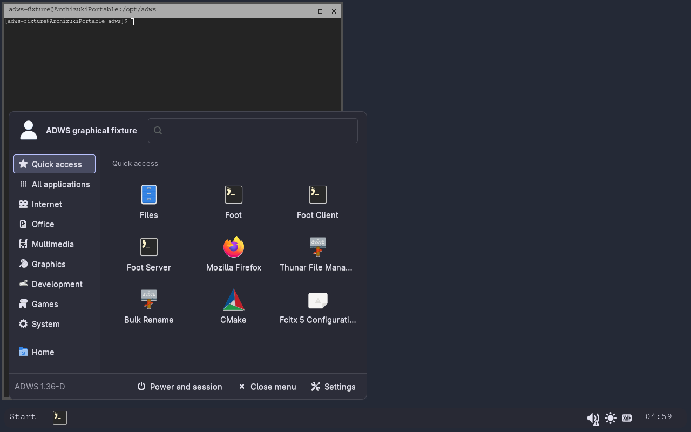
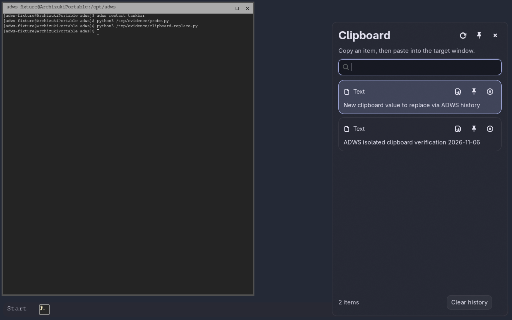
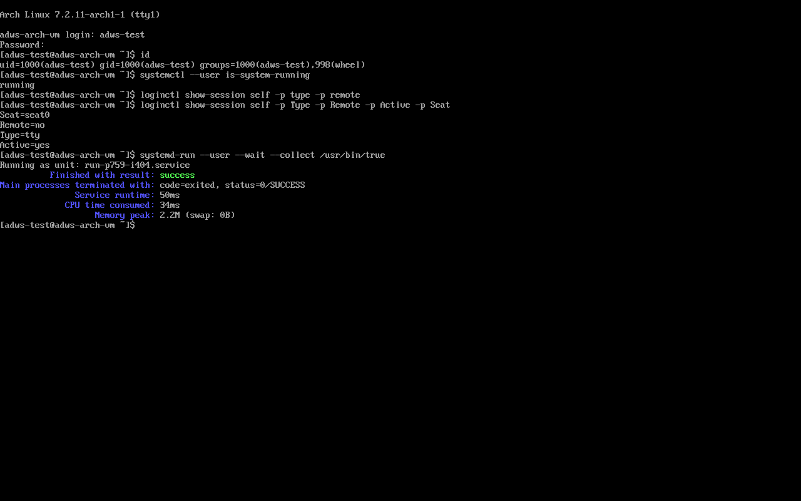
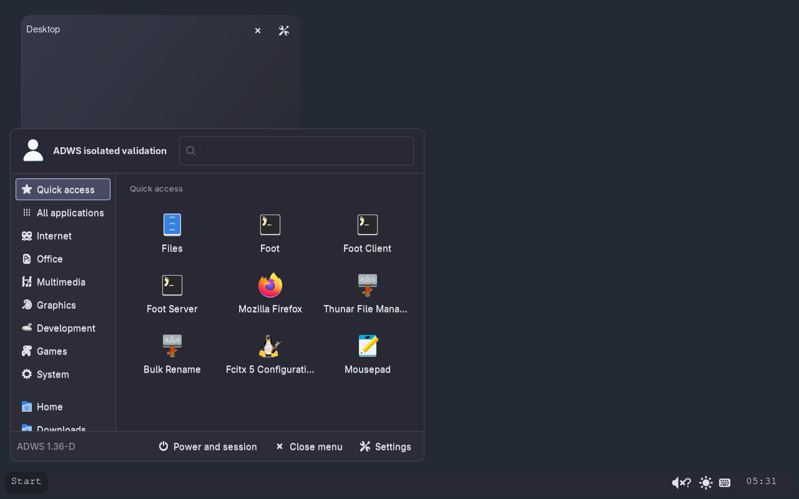
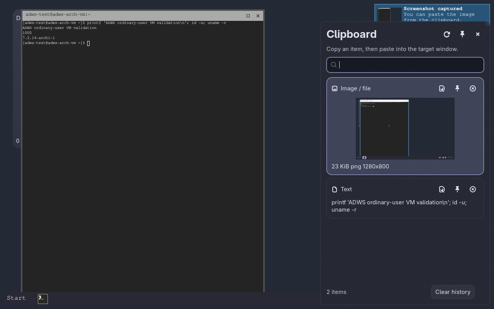
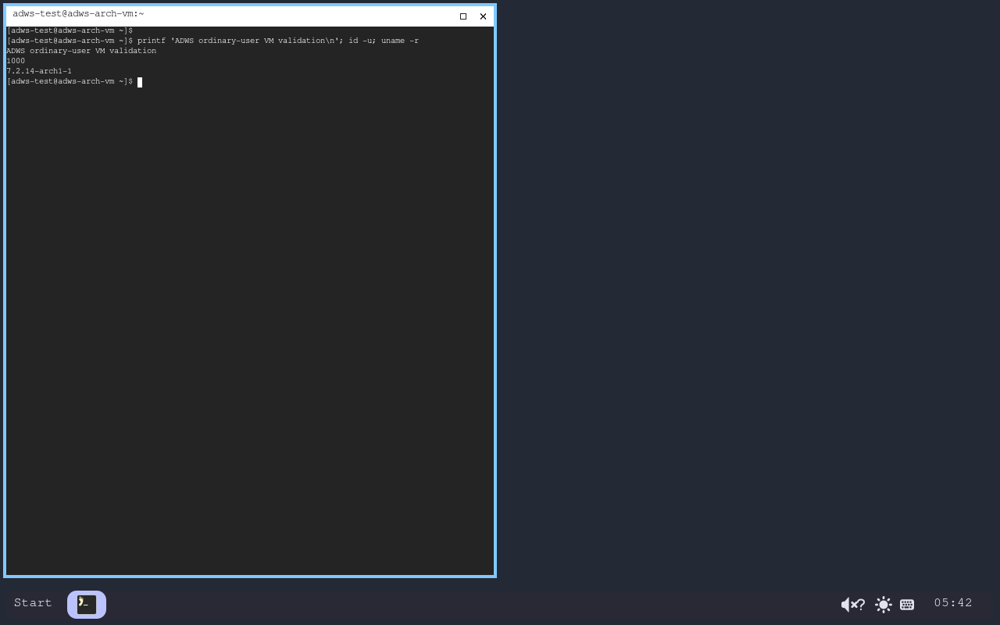
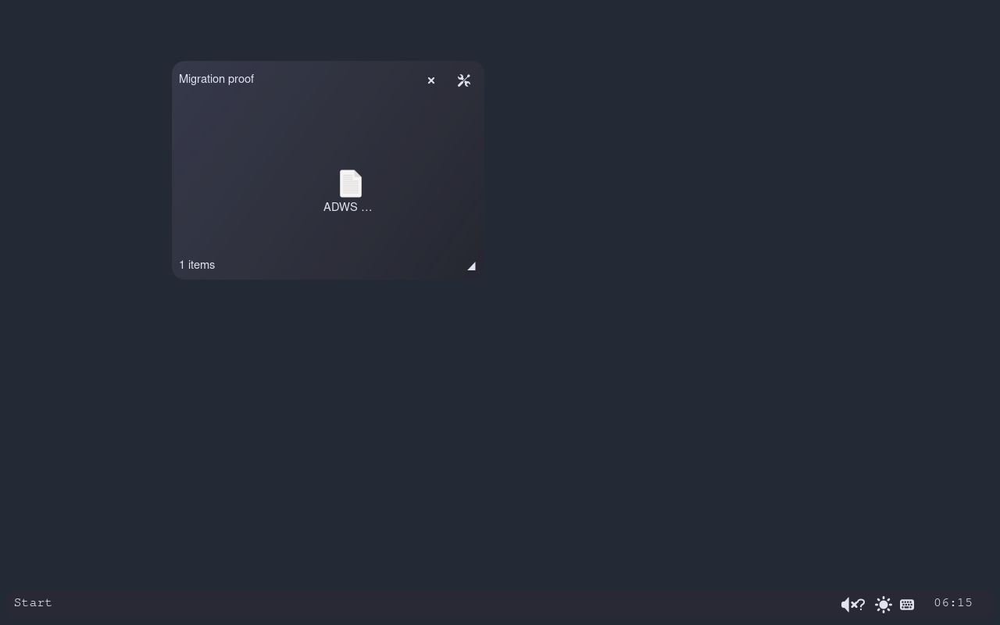
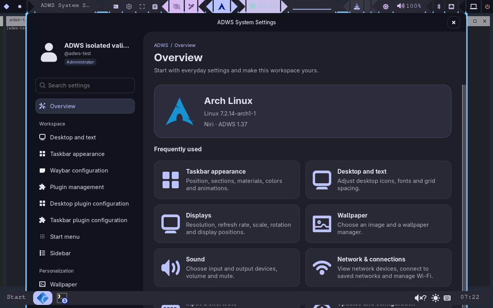

# 安装器进度与截图 · 2026-11-06

当前整体约 80%（按工作范围粗估，不是测试覆盖率）。主体安装代码已实现，功能与发布验收尚未全部完成。本批未推送、未部署到当前宿主桌面。

## 实际画面

这张图来自独立 Arch + Niri 测试环境。左侧窗口直接展示本轮安装记录，不是新设计的安装器界面；右侧是 ADWS 按默认终端配置实际启动的 Foot，底部是加载本地组件的真实任务栏。报告中的“9 步完成、0 步失败”仅指配置部署，不能当作全部功能验收通过。

此环境使用隔离 HOME、私有图形／D-Bus 会话和软件渲染，没有连接宿主桌面或硬件。它不能替代普通用户完整登录或实机测试。

此图中的开始菜单由实际鼠标点击打开，Foot 由菜单项目启动；Niri 的窗口记录确认了对应窗口。界面使用测试账户的英文环境，未修改宿主语言或主题。

剪贴板测试先写入两条不同内容，再点击较早的历史记录；读取当前剪贴板确认已由新内容切回旧内容。窗口预览目前只确认了悬停卡片及捕获请求，软件渲染环境缺少 GBM 设备，尚未取得真实缩略图，因此仍不算通过。

## 已取得的进展

| 项目 | 当前状态 |
| --- | --- |
| 三种安装模式、完整依赖、集中计划 | 已实现；隔离 Arch 中真实执行 |
| 本机习惯的默认快捷键 | 已整理；本机分支版与官方 Niri 均完成生成配置校验 |
| 默认应用 | 实际打开 Foot 终端；其他应用仍保留各自交互验收 |
| 输入法自启动 | 从没有 Fcitx 开始真实安装，最后只有一处 Niri 启动归属 |
| 续装、重复安装、失败回滚、卸载 | 已有隔离真实案例；最终组合复测继续记录 |
| 配色 | 两个真实 Foot 窗口同时刷新并正常清理辅助进程；其他目标按各自证据验证 |
| 个人迁移 | 审核与备份已实现；复杂旧状态／旧命令转换明确列冲突，未算全部完成 |
| 独立下载入口 | 校验、重试与续传已实现，独立入口已构建但尚未发布 |
| 普通用户及用户服务 | 独立 Arch 虚拟机已通过普通用户安装、SSH 与本地 tty1/PAM、用户服务检查；嵌套会话显示桌面与开始菜单，直接显示输出仍受虚拟 GPU 限制 |
| 完整支持与发布 | 真实多屏、输入法交互、升级及完整实机矩阵仍待完成 |

基线组合回归 391 项通过；随后复审修正验收中断、终止取消和旧配置迁移顺序，另有 107 项针对性复测通过（与基线有重叠，不能相加当作独立测试数）。后续结果以对应快照、原始日志及 [Arch 验证记录](installer-arch-validation.md) 为准。

原始本轮快照：`~/.local/state/adws/validation/arch-package-transition-20261106/installer-cases/20261106-124140/`。截图、生命周期日志和结果 JSON 均保存在其中。完整目标见 [安装与交付纲领](installer-roadmap.md)。

## 独立虚拟机进展

这是 QEMU 实际帧缓冲截图。独立 Arch 客体已正常引导，并通过本地 tty1/PAM 登录 UID 1000 普通用户；真实的用户服务管理器、会话总线与临时服务检查均通过。这张服务检查截图本身不证明图形界面通过；后续实际安装和嵌套桌面结果见下文。登录管理器与直接显示输出仍待实机验证。

普通用户检查的原始记录：`~/.local/state/adws/validation/arch-user-session-vm-20261106/normal-user-session.json`。客体仅使用虚拟硬件，没有挂载宿主显卡、用户会话或可写宿主系统目录。

## 普通用户安装发现的问题

旧 Arch 云镜像中的仓库数据库指向已撤下的软件包，实际依赖安装遭遇 404，安装器保留了失败记录且未写入用户桌面配置。已加入明确的完整系统升级选项和独立临时数据库预览，保留现有源与签名策略，并保留实际软件包事务的原生确认。完整升级仅在统一安装阶段执行一次，后续源码构建只检查依赖。新增模块 12 项、中央流程 33 项及安装设置 17 项测试通过（含原有用例）；普通用户只读预览确认未改变系统数据库。随后的普通用户完整安装已通过配置部署，产品仍正确返回待功能验收；详见下文，不等同于完整图形登录通过。

## 普通用户完整安装与实际菜单

独立虚拟机以 UID 1000 用户执行新审核计划：原生软件包事务的 421 项名称与版本逐项匹配预览；安装完成符号字体、五项原生组件及官方 Niri 配置。配置部署耗时约 234 秒，退出码为 **2：待功能验收**。客体随后重启至新内核 7.2.14。该轮安装的源码指纹为 `a102733b4472755f8534b29b4bac61729265dd3faeb35575c447fab49998c721`；后续解释器续接和可选主题取消修复不能追认成这一轮已测源码。

上图为该虚拟机内真实普通用户的嵌套 Niri，会话中的实际鼠标点击打开了开始菜单。进程检查确认 Fcitx5、底栏、桌面进程各一份，文本与图片剪贴板监听各一份，没有重复启动。

边界：实际 tty1 的 `niri-session` 已执行，但虚拟显卡只支持简化的 2D／软件 EGL，Niri 报缺少可用分配器，未获得直接显示输出。因此 GUI 检查另用客体内的 Xvfb／plain Niri，显式导入会话环境并使用临时测试服务持有图形会话目标；这些只属于测试夹具。首次导入前 portal 报错的原日志也保留，不将它写成产品修复或正常图形登录已经通过。原始材料在 `~/.local/state/adws/validation/arch-user-session-vm-20261106/`。

实际点击开始菜单中的 Foot 打开终端，再触发默认 `Shift+Print` 快捷键，生成 1280×800 PNG 并自动进入 ADWS 剪贴板历史。产品的任务栏及实际截图检查通过；应用启动和剪贴板 UI 操作记录为自动化实测观察，不冒充用户亲自确认。正常会话中的关键服务失败计数为 0，重启计数为 0；正常退出／重进时，Niri、Fcitx5、任务栏、桌面、通知及两类剪贴板监听均自然从 1 份变为 0，再恢复为 1；最终打包后的升级另行记录。

### 交互验收发现的剪贴板阻塞

后续直接实测原 `copy_entry`，复制的文本已经进入剪贴板，但调用在约 **8.028 秒** 后仍报超时。原因是捕获 `wl-copy` 的输出时，其后台进程保留管道，安装后的“内容读回正确”检查没覆盖这段等待。已保留原始失败证据 `logs/clipboard-original-reproduction.json`，已将 `wl-copy` 的后台输出与等待逻辑分开，保留失败诊断；同一虚拟机中修复后约 **0.646 秒** 成功返回，文本一致。另有真实 fork 子进程回归覆盖描述符继承。此前只读取内容成功的结果不能代替这一项通过，以上时间只代表该虚拟机样本。

修复后再次完成实际 GUI 回写：点击历史文本行，面板收起，聚焦 Foot 并粘贴、执行，终端输出预期的用户 ID 与内核信息。新源的 TEST 组合回归共 **492 项通过**，含安装、下载、迁移、更新、取消恢复、解释器接续和剪贴板；原始日志位于 `arch-clean-20261106/reports/final-installer-134100/`。测试入口曾误写一个不存在的测试文件名，已保留该次运行器错误记录并改用正确文件继续；不是产品失败，也未将零测试计作通过。

可选登录／启动主题的取消恢复及 Python 更换后的接续已完成实现与受控子进程回归，未冒充真实授权、引导镜像生成或实机重启已经验证。当前宿主桌面与登录配置保持原状。

## 换目录升级发现的遗漏

首次最终 ZIP（SHA-256 `8c202b963830ce4eb22425498c8a669c546469ae0820d38dfb7ca293fca3ff81`）在独立虚拟机中的换目录升级未通过验收：图标组名称、相对位置及网格恢复成默认值，部分生成的快捷键和自启动仍指向旧目录。旧目录中的原始状态完整，字体字号也保留；这不是全体配置丢失。原始失败截图、安装记录和备份保留在 `arch-user-session-vm-20261106/final-zip-complete-evidence.tar`，不能将此次部署完成视作迁移成功。

另发现通过没有显示环境的 SSH 安装时，组件重启没有沿用原桌面的会话环境；以及虚拟机中底栏刚启动、组件尚未加载时过早验收。已分别修正为仅在内存中保留运行组件的会话环境、等待实际组件加载（最多 5 秒，退出和重复启动仍报错）。

当前修复会在旧桌面停止并保存后迁移已登记的图标组和网格状态；只更新已识别的 ADWS 快捷键与自启动路径，保留键位、自定义参数和启用状态。失败时同时恢复外部包含文件及安装登记；验收续装不覆盖用户新移动的图标。旧目录内额外自定义图片、文件夹仍需单独审核，目前不属于自动资源迁移范围。

TEST 新一轮组合回归 **535 项通过**，记录在 `arch-clean-20261106/reports/source-migration-141130/`。随后补齐自定义目录 `NIRI_CONFIG` 的生成规则备份及收据校验，中央流程 **40 项**针对性复测通过（与组合测试重叠，不能相加）。新包的实际升级复测尚未完成。

### 图标组与启动路径的实包复测

新验证 ZIP `c25eb6bc23368db703bef0c7c221f0973243e26e79144b8862ce59a1418d71b6` 在原始备份恢复后，实际安装至第三个含中文和空格的新目录。不是向失败目录手工补回图标组。安装从缺少 `DISPLAY`、`WAYLAND_DISPLAY`、`NIRI_SOCKET` 的普通用户 SSH 执行，约 28.1 秒完成配置，退出码 2，正确保留“待会话验收”。产品自己沿用原组件的会话环境恢复了桌面和底栏。

实测名称 `Migration proof`、相对位置 `.25/.15`、尺寸 `400×280`、5 列及网格 `[2,1]` 全部保留，新旧状态文件逐字节一致，旧源未改；个人字号仍为 12。Niri 的 10 处受管命令与实际底栏配置已改指新目录，实际点击 Start 启动的是新目录的原生菜单。图形会话中的底栏加载及真实截图检查通过，不能扩大为所有功能已经验收。

该包另有 **195 项隔离测试**、五项原生组件的哈希和动态库检查、中文空格解压路径预览及两种引导入口验证通过。包与证据位于 `arch-package-transition-20261106/package-builds/20261106-141420/`；实际安装审计是 `arch-user-session-vm-20261106/repaired-zip-state.json`。

本轮顶栏没有启用，不能据此认为顶栏迁移通过。后续审计已确认：已有 ADWS 顶栏的按钮命令和箭头图片仍引用旧源；保留的 Foot 配色监听入口也有类似路径。正在补充保留个人主题的受管路径迁移和精确到单个顶栏的重启恢复。此验证包尚未发布，整体迁移与实机发布验收仍未完成。

### 顶栏、配色入口和源码库路径补齐

14:46 的下一轮源码已加入：从安装备份证明历史路径的顶栏／Foot 迁移；按确切配置和样式停止、恢复原本运行的顶栏；保留原会话环境；源码安装的吸附库路径迁往已安装的稳定位置。未知命令、用户自定义库、用户改过的 Foot hook 与 Shell 标记块不会被当作默认内容覆盖。

额外修复了两处审核／报告边界：Niri 包含文件即便内容哈希集合相同，符号链接改指也会使审核失效；快照没有恢复成功时，不再把步骤标成“已回滚”，并阻止旧计划直接覆盖故障现场。Foot 配色留空现在保留已登记的 bash/zsh 方式，初次配置仍仅对新窗口生效。

同步 TEST 后 **599 项组合回归通过**，原始记录是 `arch-clean-20261106/reports/topbar-migration-144742/`，包含 333 项安装测试及新增库迁移、真实临时进程取消／恢复测试。正在为该源码重建包，并在保留第 3 根安装登记、第 1 根顶栏残留引用的真实 VM 状态上进行下一轮验证；不通过回滚初始状态回避连续升级情形。

### 1.37 发布前检查

用户指定下一次推送版本为 1.37（内部 1.37.00），继续保留预发布标记。扩大打包测试发现旧 `test_topbar_features.py` 仍只替换旧剪贴板调用，已更新为解码与二进制复制的独立断言；6 项该模块测试与 3 项真实子进程复制测试通过，没有修改已修复的产品复制逻辑。

补跑了与本次未提交图标源码逐文件哈希一致的 Rust 测试：常规 16 项通过；另外在隔离 Arch、私有 Xvfb/DBus 中明确运行原先被默认跳过的实时主题测试，实际像素红蓝反复切换、原版图标保持、默认图标刷新及尺寸不变均通过。该专项 1 项通过，其余需要图形环境的 30 项仍按原测试配置跳过，不能算通过。原始材料在 `arch-package-transition-20261106/icon-theme-regression-20261106-151013/`。

另查明纯净系统文字字体缺口：NerdSymbols 不覆盖中日韩文字。正在补齐按实际字符集检测的依赖计划和安装后验收，保留用户选定字体；此项会进入 1.37 最终包和后续复测。

### 1.37 最终包实测结果

1.37（1.37.00）最终 ZIP 已构建，SHA-256 为 `69f3c6c96d2e7ef78b21352681e5edeceef46af8f7e1f9561d8b00edcc19008a`。24 组 642 项 TEST 回归通过、无跳过项；另有 28 组 442 项隔离打包回归通过，两组有重叠，不相加。包完整性、原生库依赖及引导入口通过。新增字体检查暴露的一条旧原生构建单测，已只修正模拟字体探测的边界，针对性重测通过；首次失败日志保留。

第四次换目录升级已实测故障注入后的配置恢复，再用同一审核计划续装通过。原图标组、个人顶栏样式保留；无关栏没有被重启，旧源码库引用迁往稳定安装目录。该候选上的事务测试与最终包的实际同目录部署分别留档。

最终 1.37 包已在原有中文空格目录中受控解压并执行正常安装器，真实补装中日韩字体，原配置逐字节保留，任务栏模块及截图检查通过，实际设置界面显示 1.37。此项不是线上更新器端到端测试。安装收据仍为待会话验收，物理显卡、多屏、真实 Peek 等边界没有改写为通过。

[1.37 详细验证与产物标识](verification-1.37.md)。当前本机 LIVE 环境没有部署改动。
