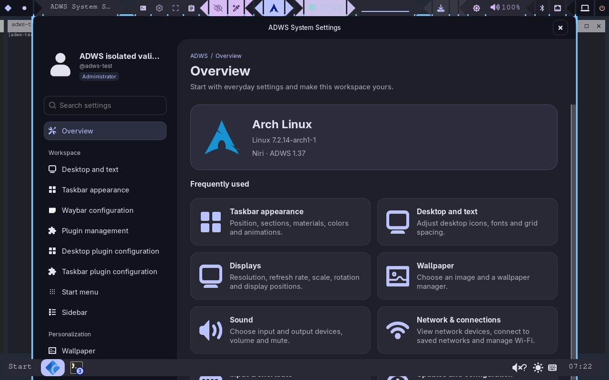

# ADWS 1.37 验证记录

日期：2026-11-06。对外版本 1.37，内部构建 1.37.00，保留预发布标记。

## 被测产物

- Arch x86_64 ZIP：`ADWS1.37_for_arch.zip`
- SHA-256：`69f3c6c96d2e7ef78b21352681e5edeceef46af8f7e1f9561d8b00edcc19008a`
- 包内安装器指纹：`abec1b6a45ee05f54e9d830df6a28a75ddfb94bb7d1df7dd9e33d3e86c8025d4`
- 独立引导包 `adws-bootstrap.pyz` SHA-256：`0819c5d2ca64fb3cf3f129a642da60aec80077883c3c8371171563935f3c4388`

包内关键产品文件与 DEV、TEST 和发布目录逐项一致。之后仅修复原生库重建单测对字体探测的隔离，以及追加验证记录；不改变该 ZIP 的产品代码。

## 自动检查

- TEST 24 组共 642 项 Python 回归通过，没有跳过项；安装、迁移、恢复、下载、更新、字体、顶栏和剪贴板均纳入。
- 独立 Arch 打包环境 28 组共 442 项回归通过；这与 TEST 有重叠，不能相加为独立用例数。
- 包完整性 178 项引用检查、五项原生组件哈希和动态库依赖检查通过；中文空格目录预览、脚本与独立引导包入口通过。
- Rust 常规测试 16 项通过；另以私有 Xvfb/DBus 明确运行实时图标主题专项 1 项，实际像素切换、原图保留、默认图刷新和尺寸不变均通过。其余 30 项默认跳过的图形／专项测试不计为通过。
- CJK 缺字检测经隔离 Fontconfig 实验验证：西文字体与 NerdSymbols 不足时加入文字字体依赖，覆盖后不再补包，原主字体选择不变。

两处旧测试使用了过宽的模拟调用：剪贴板改用独立解码／复制断言，源码库重建测试独立模拟字体已就绪。保留首次失败日志，修正后分别重跑；没有把失败隐藏或计成通过。

## 实际迁移与恢复

较早的候选包 `40c7e87098a99f3ffd2d598bd262310b9ef9fc66c2dab76fff1407bdc8a32cae` 在真实 Arch 普通用户虚拟机中进行了第四次换目录升级。前态保留第三根安装登记、第一根顶栏路径，以及自定义字号、颜色、尺寸、图标组和一条独立对照栏。

先在顶栏、Foot 和组件库路径迁移后注入一次明确测试错误：所有基线配置逐字节恢复，顶栏沿用原会话环境恢复，底栏重载旧库，对照栏 PID 与启动时间不变。随后同一审核计划正常续装通过，底栏实际加载稳定安装目录的库；新开的终端与设置入口使用新目录。故障是测试注入，不是自然发生的产品失败。

该轮运行逻辑与最终包一致；最终包另包含 1.37 元数据及文字字体补齐。最终包同目录部署的独立结果追加如下，不将较早候选的证据冒充最终包完整验收。

## 验证边界

虚拟机图形验证使用客体内 Xvfb 与嵌套 Niri。实际 tty/PAM 和普通用户服务另有证据，但虚拟显卡尚未通过直接 DRM 输出。没有把这些结果当作真实显卡、多显示器、真实窗口预览和完整实机生命周期的通过证明。

同目录部署采用受控解压新 ZIP、保留源内状态后执行正常安装计划，不是线上更新器端到端测试。本轮没有发布新的线上 Release 来替代这项测试。

平台支持仍遵循[支持等级与验收矩阵](platform-support.md)，未授予完整支持。原始日志与截图索引见[进度报告](installer-progress-2026-11-06.md)。

## 最终 1.37 包同目录实装

通过。真实包管理器安装了 `noto-fonts-cjk 20240730-1`，61 个中日韩基准字符覆盖通过，实际截图检查通过。图标组、布局、字号设置及顶栏 JSON/CSS 与更新前逐字节一致；原顶栏和独立对照栏的 PID、启动时间保持不变，底栏重启并真实加载本地原生模块。七类核心组件各一份，失败服务为 0。

设置界面实际显示 ADWS 1.37。安装从无图形环境的 SSH 发起，收据仍保留待会话验收；后续成功的任务栏、字体和截图分项不代替尚未完成的全部功能确认。

最终客体验证摘要：`arch-user-session-vm-20261106/137-final-checks.json`；完整证据归档：`137-complete-evidence.tar`。自动回归记录为 `arch-clean-20261106/reports/release-1.37-151417/verified-summary.json`，独立打包报告为 `arch-package-transition-20261106/package-builds/20261106-151439/verification-complete/report.json`。
